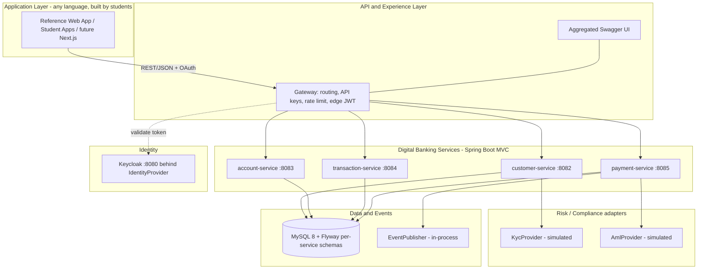
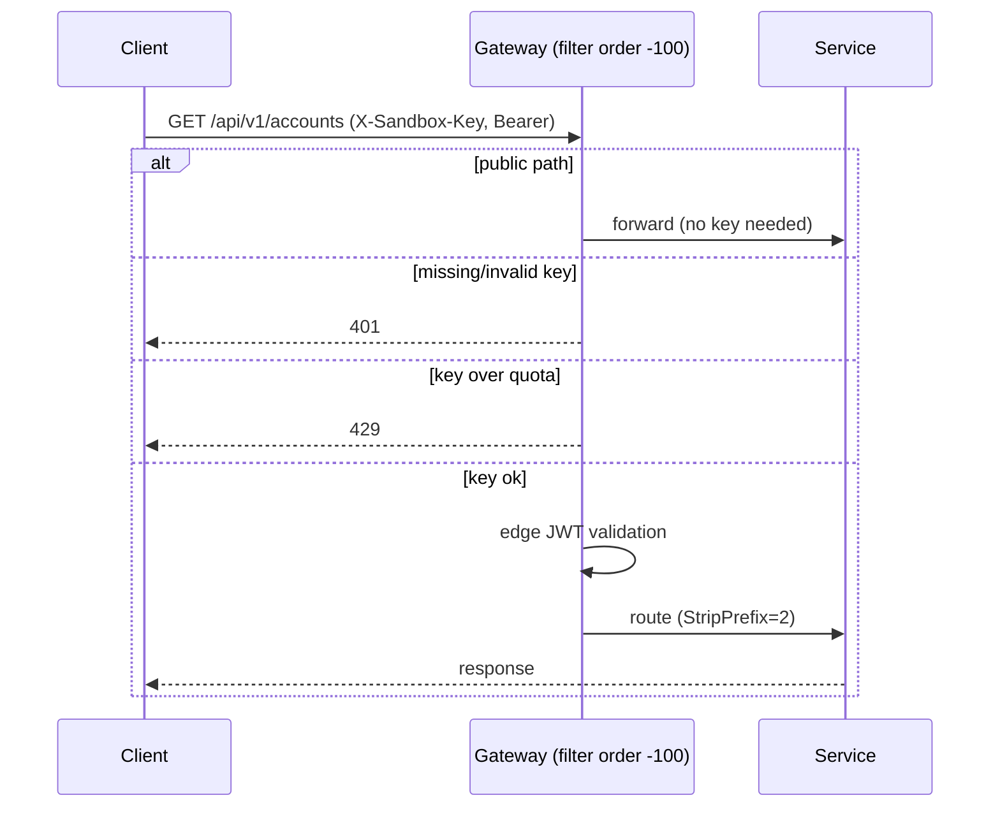

# Design Document

## Overview

The RP Digital Bank Sandbox is an educational, self-contained banking platform built as a Java 25 + Spring Boot 3.5.x multi-module Maven monorepo backed by MySQL 8. It exposes core banking APIs (customers, accounts, transactions, payments) behind a single API gateway, secured with OAuth2/OIDC JWTs issued by a simulated identity provider (Keycloak). Identity, eKYC, AML, and the event bus are all simulated in-house but sit behind adapter interfaces so they can be swapped for real vendors via configuration alone.

The design goal that shapes everything is **detachability through adapters** plus a **native-first runtime**: the whole stack runs as local processes on a laptop (no Docker required), while remaining container- and Kubernetes-ready.

This design maps directly onto the twelve requirements: the layered architecture and adapter pattern realise Requirements 1–2; the four services realise Requirements 3–7; the gateway realises Requirement 8; documentation/onboarding realise Requirement 9; admin controls realise Requirement 10; runtime/CI/containers realise Requirement 11; and the Maven/Java baseline realises Requirement 12.

### Technology baseline (Req 12)

- Java 25 (LTS), Spring Boot 3.5.6, Spring Cloud 2025.0.0 (Northfields).
- Build: multi-module Maven monorepo with a pinned parent POM and the Maven Wrapper (`mvnw`).
- Persistence: MySQL 8 (InnoDB, `DECIMAL` money, `utf8mb4`), Flyway migrations.
- Docs: springdoc-openapi 2.8.9 (WebMVC on services, WebFlux on the gateway).
- Tests: JUnit 5 + Spring Boot Test + Spring Security Test, with in-memory H2 (MySQL mode) so the build needs no running MySQL (Req 11.4).

## Architecture

### Layered view



### Module structure

Library modules (not executable):

- `common` — shared DTOs, error types, and the adapter contracts: `IdentityProvider`, `KycProvider`, `AmlProvider`, `EventPublisher`, plus `DomainEvent` / `PaymentCompletedEvent` and `ApiError` / `BusinessException`.
- `compliance-adapters` — `SimulatedKycProvider`, `SimulatedAmlProvider`, `ComplianceProperties`, `ComplianceOverrides`, auto-configured.
- `security-adapters` — `KeycloakIdentityProvider` (default) and `BuiltInIdentityProvider`, `CurrentUser`, `KeycloakRealmRoleConverter`, and the shared servlet `ResourceServerSecurityConfig`.
- `events-adapters` — `InProcessEventPublisher`, auto-configured.

Executable services: `customer-service`, `account-service`, `transaction-service`, `payment-service`, and the reactive `gateway`.

### Port map (Req 11.2)

| Component | Port |
|-----------|------|
| Keycloak | 8080 |
| gateway | 8081 |
| customer-service | 8082 |
| account-service | 8083 |
| transaction-service | 8084 |
| payment-service | 8085 |
| reference app | 3000 |

## The adapter pattern (Req 2)

Each detachable capability is an interface in `common` with implementations gated by a `provider.*` property. A missing value defaults to the simulated implementation (`matchIfMissing = true`).

```
interface IdentityProvider        // + KycProvider, AmlProvider, EventPublisher
  ├─ Keycloak / Simulated / InProcess impl   (provider.* = default)   ← v1
  └─ Vendor / BuiltIn impl                    (provider.* = vendor)    ← later
```

| Capability | Interface (`common`) | v1 implementation | Config flag |
|------------|----------------------|-------------------|-------------|
| Identity | `IdentityProvider` | `KeycloakIdentityProvider` | `provider.identity=keycloak` |
| eKYC | `KycProvider` | `SimulatedKycProvider` | `provider.kyc=simulated` |
| AML | `AmlProvider` | `SimulatedAmlProvider` | `provider.aml=simulated` |
| Events | `EventPublisher` | `InProcessEventPublisher` | `provider.events=in-process` |

Implementations are registered as beans in each adapter module's auto-configuration (listed in `META-INF/spring/org.springframework.boot.autoconfigure.AutoConfiguration.imports`) using `@ConditionalOnProperty`. Services depend only on the interface, satisfying Req 2.4. An `IdentityProviderContractTest` asserts that interchangeable identity implementations behave identically (Req 2.5).

### Decision: why beans + conditional properties (not component scanning)

Adapter implementations are plain classes registered as explicit `@Bean`s in auto-configuration, rather than `@Component`-scanned. This keeps the modules composable (a service pulls in behaviour by adding a dependency), avoids scanning another module's packages, and makes the `provider.*` switch the single source of truth for which implementation is active.

### Pattern note: object adapter, and Strategy vs Adapter

This uses the **object adapter** form (composition + delegation), not the class
adapter form (inheritance). Each implementation `implements` the target interface
(e.g. `KeycloakIdentityProvider implements IdentityProvider`) and **holds** its
collaborators as constructor-injected fields, delegating to them (for example
`InProcessEventPublisher` wraps Spring's `ApplicationEventPublisher`). No adapter
extends an adaptee. This is the more flexible GoF variant and is idiomatic in
Spring, where dependency injection is composition.

On the pattern role, to be precise for teaching:

- **Today (v1)** the simulated implementations are written directly to the
  interface and chosen at runtime by `provider.*`, so they read as the **Strategy
  (provider) pattern**: a family of interchangeable implementations behind one
  interface.
- **When a real vendor is added** — e.g. a `VendorKycProvider` that wraps a
  vendor SDK whose API is shaped differently and reshapes it to satisfy
  `KycProvider` — that wrapper is a genuine **object Adapter** (making an existing,
  incompatible interface fit the target).

The design intentionally supports both readings, which is why it is called the
"adapter/provider pattern" throughout.

## Security design (Req 4, Req 8, Req 10)

### Servlet services

A shared `ResourceServerSecurityConfig` (in `security-adapters`) configures each MVC service as an OAuth2 resource server:

- Validates JWTs against `spring.security.oauth2.resourceserver.jwt.issuer-uri` (the Keycloak realm).
- Maps Keycloak realm roles (`realm_access.roles`) to Spring authorities with a `ROLE_` prefix via `KeycloakRealmRoleConverter`.
- Permits public paths: actuator health/info, `/v3/api-docs/**`, `/swagger-ui/**`, and CORS preflight; everything else requires authentication.
- Enables method security (`@EnableMethodSecurity`) so admin endpoints can use `@PreAuthorize("hasRole('admin')")`.

**Critical wiring decision:** each service `@Import`s `ResourceServerSecurityConfig` on its `@SpringBootApplication` class rather than importing it from an auto-configuration. Defining the `SecurityFilterChain` as a user bean makes Spring Boot back off its default OAuth2 chain; importing it from auto-config instead produced two "any request" chains and an `UnreachableFilterChainException`. The config is `@ConditionalOnProperty` on the issuer-uri so services (and tests) start without a live Keycloak.

`CurrentUser` turns the current authentication into vendor-neutral `TokenClaims` and resolves `customerRef` via the active `IdentityProvider`, so no service reads vendor-specific JWT claims directly.

### Reactive gateway

The gateway is WebFlux, so it uses a parallel `GatewaySecurityConfig` (`@EnableWebFluxSecurity`, reactive resource server), also conditional on the issuer-uri. Edge concerns (API key + rate limiting) are handled by a `GlobalFilter` described below.

### Identity model

Keycloak realm `digital-bank` with a public SPA client `sandbox-web`, a `customer_ref` protocol mapper, and seeded users: `alice`, `bob` (role `customer`) and `instructor` (roles `customer` + `admin`). The realm is importable so it can be recreated with one command.

## Components and Interfaces

### customer-service (Req 3)

- `CustomerService.createCustomer(...)` calls `KycProvider.verify(...)` and persists the outcome.
- Endpoints: `POST /customers`, `GET /customers/{ref}`, `GET /customers/me`.

### account-service (Req 5)

- `AccountService.listForCustomer(ref)` and `getOwnedAccount(ref, number)` — the latter returns 404 for a non-owned account to avoid existence leakage.
- Endpoints: `GET /accounts`, `GET /accounts/{accountNumber}` (owner taken from the token).

### transaction-service (Req 6)

- `LedgerEntryRepository.findHistory(accountNumber, customerRef, from, to)` — null-range-safe, ordered newest-first.
- Endpoint: `GET /transactions/accounts/{accountNumber}?from=&to=` (owner-scoped).

### payment-service (Req 7)

- Owns its own `accounts` + `ledger_entries` tables (schema `sandbox_payment`), seeded identically to account-service, so a transfer is a single atomic local transaction. This is a deliberate v1 simplification favouring correctness and laptop-friendliness over cross-service distributed transactions.
- `PaymentService.transfer(...)` is `@Transactional`: validate amount, distinct accounts, existence, ownership, currency match, funds → `AmlProvider.screen(...)` → debit/credit + two balanced legs → publish `PaymentCompletedEvent`.
- Endpoint: `POST /payments/transfers`.

### Simulated compliance behaviour (Req 3, 7, 10)

- `SimulatedKycProvider`: name contains FRAUD → REJECTED; contains REVIEW → MANUAL_REVIEW; else configured default (APPROVED). A one-shot `ComplianceOverrides.forceNextKycStatus` takes precedence.
- `SimulatedAmlProvider`: amount ≥ flag threshold (default 10000) → FLAGGED; ≥ review threshold (default 5000) → REVIEW; else CLEAR. `ComplianceOverrides` can override the flag threshold at runtime.
- `ComplianceOverrides` is a shared in-memory holder written by the admin endpoints and read by the simulated providers; it affects only simulated providers (Req 10.6).

### gateway (Req 8)



- `ApiKeyRateLimitFilter` (a `GlobalFilter`, order −100) checks the `X-Sandbox-Key` header against configured keys, then applies per-key rate limiting; public prefixes bypass it.
- `InMemoryRateLimiter` is a dependency-free per-key sliding window (no Redis) so the gateway rate-limits in the native-first configuration (Req 8.7).
- Routes: `/api/v1/{customers,accounts,transactions,payments}/**` → services with `StripPrefix=2`; plus `/v3/api-docs/{service}` doc-routes for the aggregated UI.

### Documentation (Req 9)

- Each service ships an `OpenApiConfig` with `@OpenAPIDefinition` (title/version/description) and a `bearer-jwt` `@SecurityScheme`; key endpoints carry `@Operation` summaries.
- The gateway runs springdoc WebFlux UI with `springdoc.swagger-ui.urls` listing each service's doc-route, giving one aggregated Swagger UI.
- `GETTING_STARTED.md` documents native startup order, token retrieval, API keys, and end-to-end calls; the reference app is the worked example.

## Data Models

Each service owns its own MySQL schema; tables are created and seeded by Flyway
migrations. Money is always `DECIMAL(19,2)` (never binary floating point).

### Customer (customer-service, schema `sandbox_customer`)

| Field | Type / notes |
|-------|--------------|
| `customerRef` | string, unique, stable public id |
| `fullName` | string |
| `email` | string, unique |
| `nationalId` | string, nullable |
| `kycStatus` | enum: APPROVED / REJECTED / MANUAL_REVIEW |
| `kycReason` | string |
| `createdAt` | timestamp |

Migration: `V1__create_customers.sql`.

### Account (account-service, schema `sandbox_account`)

| Field | Type / notes |
|-------|--------------|
| `accountNumber` | string, unique |
| `customerRef` | string, owner |
| `accountType` | string (e.g. SAVINGS/CURRENT) |
| `currency` | ISO code (e.g. SGD) |
| `balance` | `DECIMAL(19,2)` |
| `status` | string (e.g. ACTIVE) |
| `createdAt` | timestamp |

Migrations: `V1__create_accounts.sql`, `V2__seed_accounts.sql` (CUST-ALICE: ACC-1001, ACC-1002; CUST-BOB: ACC-2001, ACC-2002).

### LedgerEntry (transaction-service, schema `sandbox_transaction`)

Immutable (all fields `updatable=false`); the two legs of a transfer share one `transactionRef`.

| Field | Type / notes |
|-------|--------------|
| `transactionRef` | string, groups the legs of a transfer |
| `accountNumber` | string |
| `customerRef` | string, owner (used to scope history) |
| `direction` | enum: DEBIT / CREDIT |
| `amount` | `DECIMAL(19,2)` |
| `currency` | ISO code |
| `description` | string, nullable |
| `counterparty` | string, nullable (the other account) |
| `bookedAt` | timestamp |

Migrations: `V1__create_ledger.sql`, `V2__seed_ledger.sql`.

### Payment-service tables (schema `sandbox_payment`)

The payment service owns its own copies so a transfer is one atomic transaction:

- `accounts`: like Account above, plus a `version` column (optimistic lock) and mutable `balance`.
- `ledger_entries`: like LedgerEntry above, with `transaction_ref VARCHAR(50)` to fit `TXN-<uuid>`.

Migrations: `V1__create_payment_tables.sql`, `V2__seed_payment_accounts.sql`.

### Shared value objects (common module)

- `ApiError(timestamp, status, error, message, path)` — standard error body.
- `PaymentCompletedEvent(transactionRef, fromAccount, toAccount, amount, currency, occurredAt)` — published on a successful transfer.
- `TokenClaims(subject, customerRef, roles)` — vendor-neutral view of the verified JWT.

## Error handling

- Domain violations throw `BusinessException(errorCode, message)`; each service's `@RestControllerAdvice` maps error codes to HTTP status and returns the shared `ApiError` shape (`timestamp`, `status`, `error`, `message`, `path`).
- Status mapping highlights: `ACCOUNT_NOT_FOUND`/`CUSTOMER_NOT_FOUND` → 404; `NOT_ACCOUNT_OWNER`/`NO_CUSTOMER_REF` → 403; `AML_BLOCKED` → 422; `AML_HELD` → 202; `INSUFFICIENT_FUNDS`/`SAME_ACCOUNT`/`CURRENCY_MISMATCH`/`INVALID_AMOUNT` → 409; bean-validation failures → 400 (`VALIDATION_FAILED`).

## Testing strategy

- **Adapter rule tests**: KYC and AML rule outcomes; identity provider contract test for swap-ability (Req 2.5).
- **Service integration tests** with `@SpringBootTest` + MockMvc: business-logic tests use `@AutoConfigureMockMvc(addFilters=false)`; security-sensitive tests enable the issuer-uri via `@TestPropertySource`, supply a mock `JwtDecoder` bean, and use the `jwt()` request post-processor (with `customer_ref` claim and/or `ROLE_admin`).
- **Persistence tests**: ledger integrity via `@DataJpaTest` against Flyway-migrated H2.
- **Gateway tests**: the rate-limit filter is exercised directly with mock `ServerWebExchange` for determinism; a separate limiter unit test covers windowing.
- **Docs test**: the generated OpenAPI document is served and lists the versioned endpoints.
- All tests run on in-memory H2 (MySQL mode), so `mvn verify` needs no running MySQL (Req 11.4).

## Native-first runtime, CI/CD, and containers (Req 11)

- **Native-first**: MySQL (3306), Keycloak (`kc start-dev`, 8080), the four services and the gateway run as local processes with distinct ports. DB credentials come from `DB_USERNAME`/`DB_PASSWORD` env vars; per-service databases are auto-created.
- **CI (Task 11)**: a GitHub Actions workflow builds with the Maven Wrapper and runs all tests on push/PR using JDK 25, caching Maven dependencies; deploy steps remain stubbed until containers exist.
- **Containers / K8s (Task 12)**: multi-stage Dockerfiles per service, a `docker-compose.yml` for one-command startup (MySQL + Keycloak + services + gateway), and Helm/K8s manifests mapping each service to a Deployment + Service with the gateway as ingress. Adapter `provider.*` switches surface as configuration/Helm values. No service code changes — proving the architecture was container-ready.

## Correctness Properties

Invariants the design must uphold, each stated as a property the system SHALL maintain, with the test that guards it.

### Adapter interchangeability

THE system SHALL preserve behaviour through each adapter interface when the `provider.*` value changes, so that dependents require no code change. Guarded by `IdentityProviderContractTest`. (Req 2.4, 2.5)

### Money conservation on transfer

WHEN a transfer succeeds, THE system SHALL persist exactly two balanced legs (one DEBIT and one CREDIT of equal amount sharing one `transactionRef`) atomically, so that no partial transfer is ever stored. Guarded by the payment integration test and the ledger-integrity test. (Req 7.4)

### No money movement on a rejected transfer

IF validation, ownership, funds, or AML screening fails, THEN THE system SHALL change no balance and write no ledger legs. Guarded by the payment integration tests. (Req 7.2, 7.3, 7.5, 7.6)

### Ownership isolation

THE system SHALL allow a caller to read or act only on data whose `customerRef` matches their token, and SHALL make a non-owned resource indistinguishable from a missing one (404, not 403, for reads). Guarded by the account and transaction ownership tests. (Req 5.3, 5.4, 6.5)

### Ledger immutability

THE system SHALL only insert ledger entries and SHALL never update or delete them. Guarded by the ledger-integrity test. (Req 6.1)

### Determinism of simulated compliance

THE system SHALL produce identical eKYC and AML outcomes for identical inputs unless an instructor override is active, and an eKYC override SHALL apply once and then revert. Guarded by the simulated-provider and admin-override tests. (Req 3.3, 3.4, 3.5, 7.2, 7.3, 10.5)

### Authentication and authorization

THE system SHALL reject missing or invalid tokens on every non-public endpoint with 401, and SHALL require the `admin` role for admin endpoints (403 otherwise). Guarded by the security integration tests. (Req 4.4, 10.2, 10.3, 10.4)

## Design decisions and trade-offs

1. **Payment service owns its own accounts/ledger** (v1): chosen for a single atomic InnoDB transaction and laptop simplicity, instead of distributed transactions across account/transaction services. Trade-off: seed data is duplicated; acceptable for a teaching sandbox and revisitable later.
2. **In-process events** instead of Kafka in v1: no broker to run natively; the `EventPublisher` adapter keeps a Kafka implementation a config swap away.
3. **In-memory rate limiter** instead of Redis: keeps the gateway native-first; swap for a distributed limiter when clustered.
4. **Keycloak behind an adapter** rather than hardwired: realistic OIDC for learners while preserving the confirmed requirement that it can be replaced by a built-in provider via configuration.
5. **H2 (MySQL mode) for tests** rather than Testcontainers: fastest path to a build that runs anywhere without Docker, consistent with native-first.
