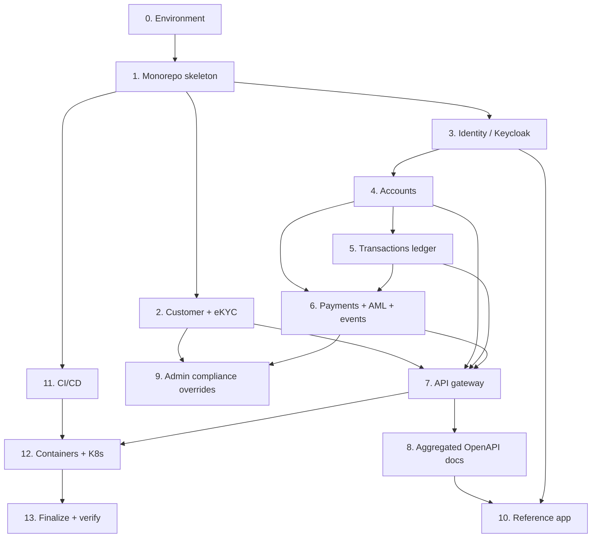

# Implementation Plan

## Overview

This plan implements the RP Digital Bank Sandbox described in `requirements.md`
and `design.md`: a Java 25 + Spring Boot multi-module monorepo with MySQL, a
Keycloak-backed identity adapter, simulated eKYC/AML/event adapters, four banking
services behind an API gateway, aggregated OpenAPI docs, a reference client app,
CI, and container/Kubernetes artifacts.

All tasks are implemented and verified: the full monorepo builds green with
`./mvnw -B -ntp verify`. Every task below is complete and marked for traceability.
Docker/Kubernetes artifacts (Task 12) are authored to standard schemas; their
first live run requires Docker or a cluster to be installed.

## Tasks

- [x] 0. Environment setup and verification (native-first)
  - Verified JDK 25 (LTS) present; confirmed MySQL 8 running on localhost:3306; confirmed Docker not required for v1.
  - Established that database credentials come from `DB_USERNAME`/`DB_PASSWORD` env vars (never hardcoded).
  - _Requirements: 11.1, 11.2, 11.3, 12.2_

- [x] 1. Project skeleton: Maven monorepo, Java 25, MySQL
  - Created the parent POM pinning Java 25, Spring Boot 3.5.6, Spring Cloud 2025.0.0, springdoc, Flyway; added the Maven Wrapper.
  - Created modules `common`, `compliance-adapters`, and the five service/gateway modules; defined the adapter interfaces (`IdentityProvider`, `KycProvider`, `AmlProvider`, `EventPublisher`) and shared error types in `common`.
  - Configured MySQL datasource + Flyway per service with distinct ports; verified `mvn verify` and `/actuator/health`.
  - _Requirements: 12.1, 12.2, 12.3, 12.4, 12.5, 2.1, 11.2_

- [x] 2. Customer service + simulated eKYC behind an adapter
  - Implemented `Customer` entity/repository, `CustomerService`, `CustomerController` (`POST /customers`, `GET /customers/{ref}`), DTOs, and the global exception handler.
  - Implemented `SimulatedKycProvider` with deterministic FRAUD/REVIEW/default rules and a configurable default; wired via `provider.kyc`.
  - Added unit tests for all KYC outcomes and an integration test for create → KYC → persist, including the FRAUD rejection and email validation.
  - _Requirements: 3.1, 3.2, 3.3, 3.4, 3.5, 3.6, 2.2, 2.3_

- [x] 3. Simulated identity via Keycloak behind the IdentityProvider adapter
  - Added `security-adapters` with `KeycloakIdentityProvider` (default) and `BuiltInIdentityProvider`, `IdentityProperties`, `CurrentUser`, `KeycloakRealmRoleConverter`, and the shared `ResourceServerSecurityConfig`.
  - Protected customer endpoints with JWT validation and added `GET /customers/me`; created the importable Keycloak realm (`sandbox-web` client, `customer_ref` mapper, seeded users).
  - Added the `IdentityProviderContractTest` proving swap-ability and a security integration test (valid token passes, missing/invalid token → 401).
  - _Requirements: 4.1, 4.2, 4.3, 4.4, 4.5, 4.6, 4.7, 2.4, 2.5_

- [x] 4. Account service with pre-seeded synthetic data and ownership scoping
  - Implemented `Account` entity (`DECIMAL` balance), repository, `AccountService` (owner-scoped list + get-by-number with 404 for non-owned), `AccountController`, DTO, and handler.
  - Added Flyway schema + seed (CUST-ALICE / CUST-BOB accounts) and an ownership integration test (own accounts only; 404 for others; 401 anonymous).
  - _Requirements: 5.1, 5.2, 5.3, 5.4, 5.5_

- [x] 5. Transaction service: append-only ledger and history
  - Implemented the immutable `LedgerEntry` entity, repository with a null-safe owner-scoped `findHistory`, `TransactionService`, and `GET /transactions/accounts/{accountNumber}` with date filtering.
  - Added Flyway schema + seeded historical transactions; added ledger-integrity and owner-scoped history tests.
  - _Requirements: 6.1, 6.2, 6.3, 6.4, 6.5, 6.6_

- [x] 6. Payment service: internal transfers + simulated AML + events
  - Added `events-adapters` with `InProcessEventPublisher` and `PaymentCompletedEvent`; implemented the payment-service self-owned accounts/ledger, `PaymentService.transfer` (atomic debit/credit + two balanced legs), `SimulatedAmlProvider` screening, and the event publish.
  - Implemented `POST /payments/transfers`, DTO, and status mapping; added integration tests (complete + event, AML held, non-owned source, insufficient funds, anonymous).
  - _Requirements: 7.1, 7.2, 7.3, 7.4, 7.5, 7.6, 7.7, 7.8, 2.2_

- [x] 7. API gateway: single entry point, API keys, rate limiting
  - Implemented `GatewayProperties`, the dependency-free `InMemoryRateLimiter`, the `ApiKeyRateLimitFilter` global filter, `GatewayConfig`, and the reactive `GatewaySecurityConfig` for edge JWT validation.
  - Configured versioned routes with `StripPrefix=2`; added filter and limiter tests (missing/unknown key → 401, over-quota → 429, public bypass).
  - _Requirements: 8.1, 8.2, 8.3, 8.4, 8.5, 8.6, 8.7_

- [x] 8. Aggregated OpenAPI / Swagger UI + onboarding docs
  - Added per-service `OpenApiConfig` (title/description + bearer-jwt scheme) and `@Operation` summaries; configured the gateway's aggregated Swagger UI with per-service doc-routes.
  - Wrote `GETTING_STARTED.md`; added a docs test asserting the OpenAPI document lists the versioned endpoints.
  - _Requirements: 9.1, 9.2, 9.3, 9.4_

- [x] 9. Instructor admin endpoints for configurable compliance outcomes
  - Enabled method security; added admin endpoints to force the next eKYC outcome (customer-service) and override the AML flag threshold (payment-service), restricted to the `admin` role.
  - Added an integration test (admin forces rejection and it applies; non-admin → 403; anonymous → 401).
  - _Requirements: 10.1, 10.2, 10.3, 10.4, 10.5, 10.6_

- [x] 10. Reference client application (end-to-end example)
  - [x] 10.1 Build the framework-free OIDC client
    - Created `reference-app/` with `index.html`, `app.js`, `app.css`, and `config.js` using `keycloak-js` (Authorization Code + PKCE) against the `sandbox-web` client.
    - Implemented login/logout, then calling the gateway with `Authorization: Bearer <token>` and the `X-Sandbox-Key` header; centralised calls in one `api()` helper.
    - _Requirements: 1.1, 1.2, 1.3, 1.4, 9.5_
  - [x] 10.2 Implement the account/statement/transfer views
    - Lists the signed-in customer's accounts, shows a selected account's statement, and submits a transfer; renders success and error (AML held/blocked, insufficient funds) states.
    - _Requirements: 1.1, 5.3, 6.3, 7.1, 7.4_
  - [x] 10.3 Document and verify the reference app
    - Added `reference-app/README.md` with native run instructions (serve on port 3000) and a note on reusing it as a template for other languages/frameworks.
    - Verified the full build still passes; confirmed the Keycloak realm already permits the `localhost:3000` redirect/web origin.
    - _Requirements: 9.4, 9.5, 1.4_

- [x] 11. GitHub Actions CI/CD pipeline
  - [x] 11.1 Add the build-and-test workflow
    - Created `.github/workflows/ci.yml` that runs on push and pull request, sets up JDK 25, caches Maven, and runs `./mvnw -B -ntp verify` (tests use H2, so no MySQL service is needed).
    - _Requirements: 11.4, 11.5, 12.3, 12.5_
  - [x] 11.2 Prepare the pipeline for later deployment
    - Added a stubbed, manually-triggered (`workflow_dispatch`) deploy job (no-op until containers exist) so the deploy path is wired but inert.
    - _Requirements: 11.5, 11.6_

- [x] 12. Containerization and Kubernetes-readiness
  - [x] 12.1 Add per-service Dockerfiles
    - Added a multi-stage Dockerfile (JDK 25 build → JRE runtime) for each service and the gateway, building the Spring Boot jar via the wrapper; config parameterised via environment variables; added `.dockerignore`.
    - _Requirements: 11.6, 11.3_
  - [x] 12.2 Add docker-compose for one-command startup
    - Added `docker-compose.yml` running MySQL, Keycloak (realm import), the four services, and the gateway with correct ports, health checks, and `provider.*`/DB env wiring; parameterised the gateway's service URIs so the same build runs native, in compose, and in K8s.
    - _Requirements: 11.6, 11.1_
  - [x] 12.3 Add Kubernetes manifests
    - Added Deployment + Service manifests for each service, a ConfigMap (settings + adapter `PROVIDER_*` switches) and Secret (DB creds), and the gateway as an Ingress; documented promoting from compose to a local cluster (kind/minikube) and client-side validation.
    - _Requirements: 11.6_

- [x] 13. Finalize spec bookkeeping and full verification
  - Updated `README.md` task progress (Tasks 9–12) and added sections for the reference app, Docker, Kubernetes, and CI; removed temporary build artifacts.
  - Ran a full `./mvnw -B -ntp verify` and confirmed the whole monorepo builds green with all tests passing.
  - _Requirements: 12.5_

## Task Dependencies

Per-task dependencies (task: depends on):

- Task 0: depends on none
- Task 1: depends on Task 0
- Task 2: depends on Task 1
- Task 3: depends on Task 1
- Task 4: depends on Task 3
- Task 5: depends on Task 4
- Task 6: depends on Task 4, Task 5
- Task 7: depends on Task 2, Task 4, Task 5, Task 6
- Task 8: depends on Task 7
- Task 9: depends on Task 2, Task 6
- Task 10: depends on Task 3, Task 8
- Task 11: depends on Task 1
- Task 12: depends on Task 7, Task 11
- Task 13: depends on Task 12

## Notes

- Verification: the Java build and all tests are confirmed green via `./mvnw -B -ntp verify` on the development machine. Tests run on in-memory H2 (MySQL mode), so no running MySQL is required to build.
- Not yet run live (requires tooling to be installed): `docker compose up`, Kubernetes `kubectl apply`, and the first GitHub Actions run on push. These artifacts follow standard schemas and package the verified Java build.
- Detachability: identity, eKYC, AML, and events each sit behind an adapter selected by a `provider.*` property; swapping a simulated provider for a vendor is a configuration change, with no service code changes (see `design.md`).
- Native-first: the sandbox runs as local processes with no Docker; Docker and Kubernetes are additive, optional graduation steps.
